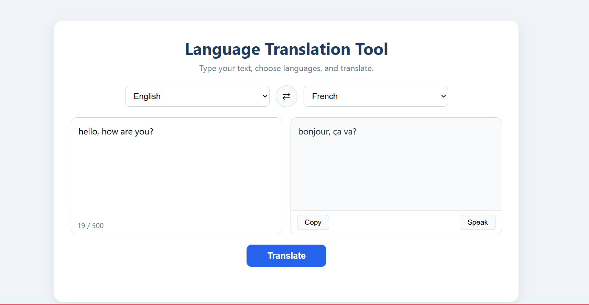

# Language Translation Tool

A web app that translates text between multiple languages. Built with a Python Flask backend and an HTML/CSS/JavaScript frontend.



## Features

- Translate text between 14 languages (English, Urdu, Arabic, Hindi, French, German, Spanish, Italian, Portuguese, Russian, Turkish, Chinese, Japanese, Korean)
- Swap source and target languages with one click
- Copy translated text to clipboard
- Text-to-speech for the translated text
- Character counter (500 character limit)
- Clear error messages for empty input, same languages and server problems

## Tech Stack

- **Backend:** Python, Flask, Flask-CORS, Requests
- **Frontend:** HTML, CSS, JavaScript
- **Translation API:** MyMemory Translation API (the API call lives in one function, so it can be replaced with Google Translate or Microsoft Translator easily)

## How to Run

1. Clone the repository and open the folder.
2. Create and activate a virtual environment:
```
   python -m venv venv
   venv\Scripts\activate
```
3. Install the libraries:
```
   pip install -r requirements.txt
```
4. Copy `.env.example` to a new file named `.env` and add your email.
5. Start the backend:
```
   python app.py
```
6. Open `index.html` in your browser.

## Project Structure

```
app.py          Flask backend (API routes and translation logic)
index.html      Page structure
style.css       Design
script.js       Frontend logic (API calls, copy, speak, swap)
requirements.txt
.env.example
```

## Author

Zainab Batool